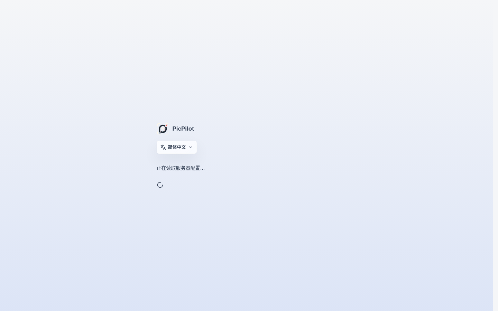

# PicPilot Platform

[简体中文](README.md) | [English](README.en.md) | [日本語](README.ja.md)

PicPilot's creator-focused multi-user AI studio for visual commerce and content teams. It combines a Go business backend with reference-image workflows, image/text/video generation, a creative studio, infinite canvas and an operator console for accounts, tasks, credits, payments, risk controls and model providers.

**Public migration acceptance build; production readiness has not been declared.** See the [acceptance checklist](docs/implementation-status.md). Never point it at the old production database. The Go edition has its own schema and does not automatically import Java data.

## Editions

| Repository | Purpose |
| --- | --- |
| Original openImage Java repository | Existing platform, preserved separately |
| `suakitsu/picpilot-platform` | Multi-user platform; operators configure models, credits and payments |
| `suakitsu/picpilot-personal` | Self-hosted personal edition; configure your own providers without platform billing or an administrator console |

Each Go repository includes its own shared-core snapshot and frontend sources. One clone is sufficient; a second repository is not a build dependency. React/Next.js still renders the frontend. Next handles rendering and transport only; Go owns business logic, task execution and storage.

## Quick Start

Install Git, a running Docker Engine or Docker Desktop, and Docker Compose v2. The first build needs access to image registries and npm/Go dependency sources. Allow at least 4 CPU cores, 8 GB available memory and 10 GB free disk. Builds are concurrency-limited; no reboot is performed.

```sh
git clone https://github.com/suakitsu/picpilot-platform.git
cd picpilot-platform
```

The repository is public; cloning does not require a GitHub token.

Windows PowerShell:

```powershell
./scripts/init.ps1
docker compose up -d --build
docker compose ps
docker compose exec api /picpilot --setup-token
```

Linux / macOS:

```sh
sh scripts/init.sh
docker compose up -d --build
docker compose ps
docker compose exec api /picpilot --setup-token
```

1. Open the [user site](http://localhost:8080) and create the initial administrator using the setup token printed by the final command. Keep that token private.
2. Open the [administrator console](http://localhost:8081) and sign in with that account.
3. Add your image, text or video provider. Select the actual compatible protocol and model, enter its key, then enable it explicitly. Configuration checks do not call a paid model.
4. Registration, payment channels and Local Worker providers start disabled. Configure them before opening the service to other users.

There are no default credentials. The initializer creates a random database password. On first start, Go generates separate encryption, session and signing keys in the application volume. **Keep `instance-secrets.json`; deleting it makes saved provider credentials unreadable.**

Only `127.0.0.1:8080/8081` is published by default. PostgreSQL has no host port. For port conflicts, edit both ports and their public URLs in `.env` before starting. Never use `docker compose down -v` as a shutdown command: it deletes persistent data.

## Cold-start acceptance

The commands above are the complete startup path. A fresh clone does not depend on the personal
edition or another checkout:

```powershell
./scripts/init.ps1                 # first run only: writes .env and a random DB password
docker compose up -d --build       # builds the Go API, user site, admin site and gateway
docker compose ps                   # wait for db/api/user/admin/gateway to be running/healthy
docker compose exec api /picpilot --setup-token
```

The setup token is printed once in the terminal. Open `http://localhost:8080` to create the first
administrator, then `http://localhost:8081` to verify the administrator console. Startup is complete
when the user/login page is visible and the API has passed its Compose health check. On Linux/macOS,
use `sh scripts/init.sh` for the first command. The remaining commands are identical.

The isolated acceptance run used an empty database and temporary Compose project. It verified image
builds, migrations, first account creation, login, encrypted provider settings, mock image/text jobs,
idempotency, signed media and logout. These screenshots are local browser acceptance evidence; they
contain no production data and do not call a paid model.

The following screenshots were recaptured on 2026-10-30 from the current demo environment at a 1440px desktop viewport. They cover the administrator console and the user sign-in, workspace, AI creation and history pages; they are not mobile views or narrow crops. The demo uses an isolated database and Demo mode, so it does not call live models or payment services.





Troubleshooting:

- `POSTGRES_PASSWORD` is missing: run `init.ps1`/`init.sh`; do not hand-write production secrets.
- Docker Engine is unavailable: start Docker Desktop and confirm `docker info` returns Server data.
- A port is busy: change `PICPILOT_HTTP_PORT`, `PICPILOT_ADMIN_PORT`, both public URLs, and keep
  the values consistent in `.env`.
- The page does not load: inspect `docker compose ps` and
  `docker compose logs --tail=100 api gateway`; do not delete volumes first.
- Use `docker compose stop` for routine shutdown. Follow [operations](docs/operations.md) before
  upgrades, and never use `docker compose down -v` unless you intentionally want to erase data.

## Scope

- Image, text and video use persistent jobs, polling, ownership checks and duplicate-submission protection. Ordinary HTTP providers and Local Worker providers remain separate execution modes.
- Listing, A+, commerce suites, translation, creative images/chat, video and both canvases are verified against the acceptance checklist.
- Platform operations include users, credits, payment history, moderation, prompts, tasks and usage records. A clean installation contains no customer or historical production data.
- Local Worker only makes outbound HTTPS long-poll requests. It does not need a public port or upload its local gateway credentials. [Protocol v1](docs/local-worker-protocol-v1.md) is authoritative.
- A localhost or loopback `PICPILOT_PUBLIC_URL` automatically enables trusted local HTTP/private gateways. Set `PICPILOT_ALLOW_PRIVATE_PROVIDERS=false` for a public deployment.
- Provider compatibility depends on the actual protocol and model. Vendor labels alone do not guarantee compatibility. Default tests never invoke paid models or live payment services.

## Operations

- [Configuration, HTTPS and Local Worker](docs/configuration.md)
- [Backups, restores, upgrades and rollback](docs/operations.md)
- [Testing and safety](docs/testing.md)
- [Implementation and acceptance status](docs/implementation-status.md)

```sh
docker compose logs --tail=100 api
docker compose stop
docker compose start
```

For a lost owner password without email configured, use [local owner recovery](docs/operations.md#owner-recovery). Do not bypass hashing or session revocation with manual plaintext database updates.

## Acknowledgements

PicPilot thanks the following open-source projects for the canvas capabilities. Their licenses,
corresponding source and attribution obligations are retained while PicPilot adds branding,
authentication-aware task bridges and scoped storage:

- [Nova Image Studio](https://github.com/tianjiangqiji/nova-image-studio): creative studio,
  version `3.1.3`, pinned commit `7768f3f8d7f47e04c6d18572837a086c7a533161`, AGPL-3.0.
- [Infinite Canvas](https://github.com/basketikun/infinite-canvas): infinite canvas,
  pinned commit `705fdd9b2f7bfe6fd58156fd5c1cdb1ad251c767`, GNU AGPL v3.

License, provenance and modification notes are kept in
`third_party/nova-image-studio/UPSTREAM.md` and `third_party/infinite-canvas/PROVENANCE.txt`.

## Source and License

PicPilot's original code owned by suakitsu is available under [MIT](LICENSE). The bundled third-party canvases and Nova data in `core/nova/defaults/` retain AGPL-3.0. The combined application is distributed under AGPL-3.0 and is not MIT-only. See [Licensing](LICENSING.md) for scope, third-party notices and corresponding-source obligations.

Environment files, keys, databases, uploads, backups, dependency caches and generated builds do not belong in Git.
