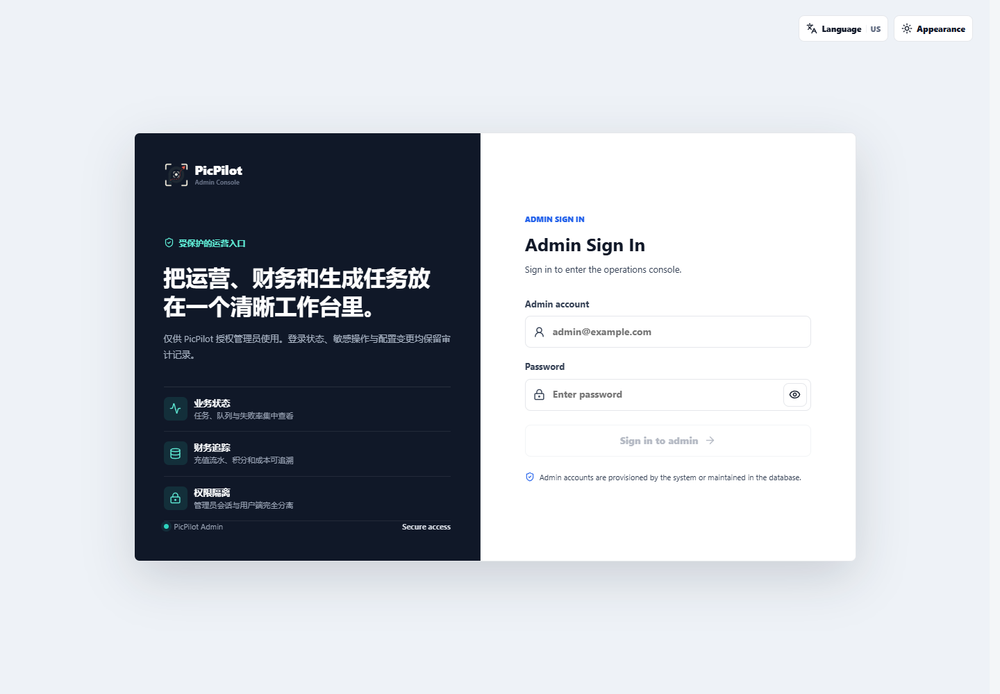
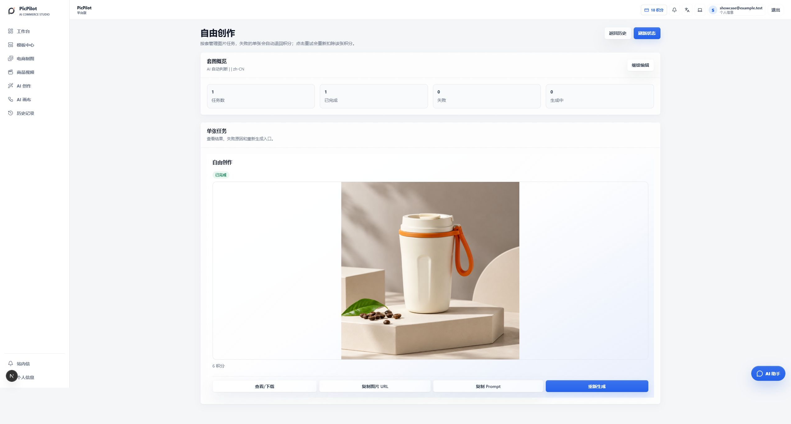

# PicPilot Platform

[简体中文](README.md) | [English](README.en.md) | [日本語](README.ja.md)

運営者向けの PicPilot プラットフォーム版です。業務バックエンドを Go で実装し、ユーザー画面、管理画面、創作スタジオ、自由キャンバスを備えます。アカウント、永続タスク、ポイント、決済、リスク管理、モデル設定を同じバックエンドで扱います。

**現在は非公開の移行検証版です。本番利用可能との宣言はまだしていません。** [検証チェックリスト](docs/implementation-status.md)を確認してください。旧本番データベースには接続しないでください。Go 版は独立したスキーマを使用し、Java 版のデータを自動移行しません。

## エディション

| リポジトリ | 用途 |
| --- | --- |
| 元の openImage Java リポジトリ | 従来のプラットフォーム版。別途保持します |
| `suakitsu/picpilot-platform` | 複数ユーザー向け。管理者がモデル、ポイント、決済を設定します |
| `suakitsu/picpilot-personal` | 個人向け。自分のモデルを設定し、プラットフォーム課金や管理画面を使用しません |

各 Go リポジトリには共通コアのスナップショットとフロントエンドが含まれます。もう一方の非公開リポジトリはビルドに不要です。フロントエンドは React/Next.js のままです。Next は画面描画と転送のみを担当し、業務処理、タスク実行、保存処理は Go が担当します。

## クイックスタート

Git、起動中の Docker Engine または Docker Desktop、Docker Compose v2 が必要です。初回ビルドではコンテナ、npm、Go の配布元に接続します。4 CPU コア、利用可能メモリ 8 GB、空きディスク 10 GB 以上を推奨します。ビルドの並列数は制限されており、自動再起動は行いません。

```sh
git clone https://github.com/suakitsu/picpilot-platform.git
cd picpilot-platform
```

非公開期間中はアクセス権を持つ GitHub アカウントが必要です。アクセストークンをクローン URL に埋め込まないでください。

Windows PowerShell:

```powershell
./scripts/init.ps1
docker compose up -d --build
docker compose ps
docker compose exec api /picpilot --setup-token
```

Linux / macOS:

```sh
sh scripts/init.sh
docker compose up -d --build
docker compose ps
docker compose exec api /picpilot --setup-token
```

1. [ユーザー画面](http://localhost:8080)を開き、最後のコマンドで表示された初期化トークンを使って管理者を作成します。トークンは他人に渡さないでください。
2. [管理画面](http://localhost:8081)に同じアカウントでログインします。
3. 画像、テキスト、動画の Provider を追加します。実際の互換プロトコル、モデル、キーを設定してから有効化します。設定チェックでは有料モデルを呼び出しません。
4. 新規登録、決済、Local Worker Provider は初期状態で無効です。必要な設定を行ってから公開してください。

既定のアカウントやパスワードはありません。初期化スクリプトはランダムなデータベースパスワードを生成します。初回起動時にアプリケーション用ボリュームへ独立した暗号化・セッション・署名キーを作成します。**`instance-secrets.json` を削除すると、保存済み Provider キーを復号できなくなります。**

既定では `127.0.0.1:8080/8081` のみ公開し、データベースのホスト側ポートは開きません。ポートが競合する場合は、起動前に `.env` のポートと公開 URL を合わせて変更してください。`docker compose down -v` はデータを削除するため、通常の停止に使用しないでください。

## コールドスタート検証

上記のコマンドだけで新しいクローンを起動できます。もう一方の非公開リポジトリには依存しません。

```powershell
./scripts/init.ps1                 # 初回のみ。`.env` とランダムな DB パスワードを作成
docker compose up -d --build       # Go API、ユーザー画面、管理画面、ゲートウェイを構築
docker compose ps                   # db/api/user/admin/gateway が running/healthy になるまで待つ
docker compose exec api /picpilot --setup-token
```

端末に表示される初期化トークンは一度だけ使えます。`http://localhost:8080` で最初の管理者を作成し、
`http://localhost:8081` で管理画面を確認します。ユーザー画面またはログイン画面が表示され、API の
ヘルスチェックが通れば起動完了です。Linux/macOS では最初のコマンドを `sh scripts/init.sh` に置き換えます。

独立した検証では空のデータベースと一時 Compose プロジェクトを使い、イメージ構築、マイグレーション、
最初のアカウント、ログイン、暗号化 Provider 設定、Mock 画像/テキストタスク、冪等性、署名メディア、
ログアウトを確認しました。以下はローカルブラウザー検証の画面であり、本番データや有料モデルは含みません。

以下は以前に完全なデスクトップブラウザー画面から取得した 1440px の検証画像です。モバイル表示や細長い切り抜きではありません。




### 実 Provider の表示例（2026-10-30）

隔離したローカルデータディレクトリで OpenAI Images 互換の Sualoom Provider（`gpt-image-2`）を設定し、プラットフォーム版の自由創作から 1K 正方形の無ブランド携帯コーヒーカップ商品画像を実際に生成しました。下の画像は成功した成品詳細ページの実画面で、上の Mock 検証画像とは分けています。既定のテスト手順ではなく、上流サービスの規約により料金が発生する場合があります。



トラブルシューティング：

- `POSTGRES_PASSWORD` がない場合は `init.ps1`/`init.sh` を先に実行します。本番秘密情報を手入力しないでください。
- Docker Engine が利用できない場合は Docker Desktop を起動し、`docker info` が Server 情報を返すことを確認します。
- ポート競合時は `.env` の `PICPILOT_HTTP_PORT`、`PICPILOT_ADMIN_PORT`、両方の公開 URL を一緒に変更します。
- ページが開かない場合は `docker compose ps` と `docker compose logs --tail=100 api gateway` を確認し、先にボリュームを削除しないでください。
- 通常停止は `docker compose stop` を使います。更新前は [運用手順](docs/operations.md) でバックアップし、`docker compose down -v` はデータ消去を意図するとき以外使いません。

## 対応範囲

- 画像・テキスト・動画は永続タスク、状態ポーリング、所有者確認、重複送信防止を使用します。HTTP Provider と Local Worker は独立した実行方式です。
- Listing、A+、商品画像セット、翻訳、自由創作、画像チャット、動画、両キャンバスをチェックリストに沿って検証します。
- 管理機能にはユーザー、ポイント、入金履歴、リスク管理、プロンプト、タスク、利用記録が含まれます。新規インストールには旧顧客データを含めません。
- Local Worker は外向き HTTPS ロングポーリングのみを使います。公開ポートやローカルゲートウェイの秘密情報送信は不要です。[Protocol v1](docs/local-worker-protocol-v1.md)が唯一の正式仕様です。
- 互換性は実際のプロトコルとモデルに依存します。事業者名だけで互換性を保証しません。既定のテストでは有料モデルや実決済を使用しません。

## 運用

- [設定・HTTPS・Local Worker](docs/configuration.md)
- [バックアップ・復元・更新・ロールバック](docs/operations.md)
- [テストと安全上の制約](docs/testing.md)
- [実装・検証状況](docs/implementation-status.md)

```sh
docker compose logs --tail=100 api
docker compose stop
docker compose start
```

メール未設定で所有者のパスワードを忘れた場合は、[ローカル復旧手順](docs/operations.md#owner-recovery)を使用してください。平文パスワードを DB に直接書き込まないでください。

## 謝辞

キャンバス機能を提供してくださった以下のオープンソースプロジェクトに感謝します。PicPilot は対応するライセンス、ソース、表示義務を保持したうえで、ブランド、認証、タスク連携、保存方式を適用しています。

- [Nova Image Studio](https://github.com/tianjiangqiji/nova-image-studio)：制作スタジオ。バージョン `3.1.3`、固定コミット `7768f3f8d7f47e04c6d18572837a086c7a533161`、AGPL-3.0。
- [Infinite Canvas](https://github.com/basketikun/infinite-canvas)：自由キャンバス。固定コミット `705fdd9b2f7bfe6fd58156fd5c1cdb1ad251c767`、GNU AGPL v3。

ライセンス、由来、変更内容は `third_party/nova-image-studio/UPSTREAM.md` と `third_party/infinite-canvas/PROVENANCE.txt` に保存しています。

## ソースとライセンス

[AGPL-3.0](LICENSE) を適用します。変更済みキャンバスの対応ソース、ライセンス、由来は `third_party/*/UPSTREAM.md` に保持します。名称変更によってライセンス義務は消えません。所有者の明示的な許可までは、両 Go リポジトリを非公開のまま維持します。

環境ファイル、キー、データベース、アップロード、バックアップ、キャッシュ、生成物を Git に追加しないでください。
