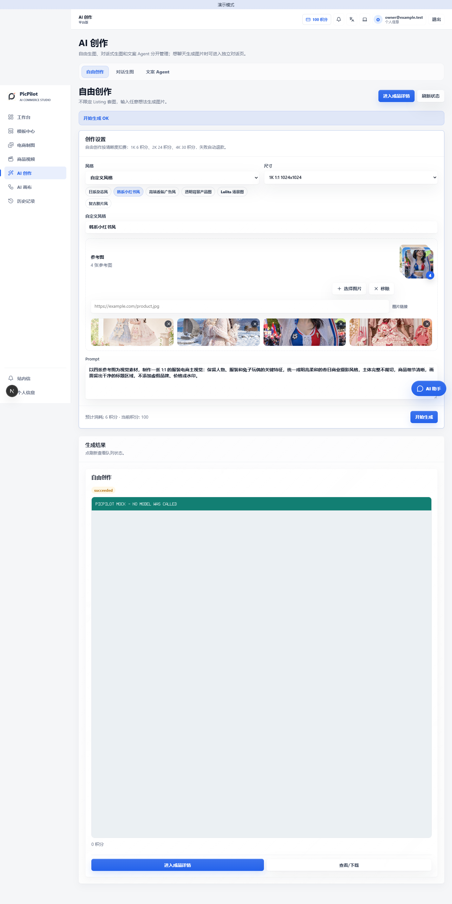

# PicPilot Platform Go

[简体中文](README.md) | [English](README.en.md) | [日本語](README.ja.md)

面向运营者的 PicPilot 平台版。业务后端使用 Go，保留用户工作台、管理员后台、创作工作台和自由画布。用户、任务、积分、充值、风控和 Provider 由同一套服务管理。

**当前为私有迁移验收版本，尚未宣布正式可用。** 完整验收记录见 [实施清单](docs/implementation-status.md)。不要连接旧生产数据库；本版本有独立数据库结构，不会自动导入 Java 版数据。

## 版本选择

| 仓库 | 用途 |
| --- | --- |
| 原 openImage Java 仓库 | 原平台版，独立保留，不受本次迁移修改 |
| `suakitsu/picpilot-platform-go` | 多用户平台，管理员统一配置模型、积分和支付 |
| `suakitsu/picpilot-personal-go` | 自用版，用户在自己的设置页配置模型，无平台充值和管理后台 |

两个 Go 仓库各自包含完整源码和共享模块快照，克隆一个即可构建，不需要再下载另一个私有仓库。前端仍使用 React/Next.js；Next 仅负责页面渲染和 API 转发，业务、任务执行和存储由 Go 实现。

## 快速启动

需要 Git，以及 Docker Engine/Docker Compose v2，或本机 Go、Node.js 和 PostgreSQL。Docker 只是打包启动方式，不是运行前提。首次构建需要访问容器镜像和 npm/Go 依赖源。建议至少 4 核、8 GB 可用内存及 10 GB 可用磁盘；构建顺序受到限制，不会自动重启机器。

```sh
git clone https://github.com/suakitsu/picpilot-platform-go.git
cd picpilot-platform-go
```

仓库私有期间需要自己的 GitHub 读取权限。不要把访问令牌写进克隆地址。

Windows PowerShell：

```powershell
./scripts/init.ps1
docker compose up -d --build
docker compose ps
docker compose exec api /picpilot --setup-token
```

Linux / macOS：

```sh
sh scripts/init.sh
docker compose up -d --build
docker compose ps
docker compose exec api /picpilot --setup-token
```

1. 打开 [用户站点](http://localhost:8080)，按初始化页面提示创建管理员账号。初始化令牌由最后一条命令在你的终端显示，勿发给他人。
2. 打开 [管理员后台](http://localhost:8081)，使用刚创建的账号登录。
3. 在 Provider 配置中添加自己的图片、文本或视频服务，填入真实兼容协议、模型和密钥，再明确启用。配置检查不会调用付费模型。
4. 新实例默认关闭注册、支付和 Local Worker Provider；按需要配置后再开放给用户。

没有默认账号或默认密码。初始化脚本生成随机数据库密码；应用第一次启动时在数据卷里生成独立加密、会话和签名密钥。**不要删除数据卷中的 `instance-secrets.json`，否则已保存的 Provider 密钥无法解密。**

默认仅监听 `127.0.0.1:8080/8081`，数据库没有宿主机端口。端口冲突时，在启动前修改 `.env` 的端口及对应的公开 URL。不要通过 `docker compose down -v` 停机，该命令会删除数据。

## 冷启动验收

上面的命令是完整启动路径，不依赖另一个 PicPilot 仓库。每次新克隆建议按下面顺序执行：

```powershell
./scripts/init.ps1                 # 只需首次执行，生成 .env 和随机数据库密码
docker compose up -d --build       # 构建 Go API、用户站点、管理后台和网关
docker compose ps                   # 等待 db/api/user/admin/gateway 为 running/healthy
docker compose exec api /picpilot --setup-token
```

初始化令牌只在终端显示一次。打开 `http://localhost:8080` 创建首个管理员，再打开
`http://localhost:8081` 验证管理后台。看到用户首页或登录页、管理后台登录页，且
`docker compose ps` 中 API 已通过健康检查，就表示快速启动完成。Linux/macOS 将第一行替换为
`sh scripts/init.sh`；后续命令相同。

本次独立验收使用空数据库和临时 Compose 项目完成：镜像构建、数据库迁移、首次账号、登录、
Provider 加密配置、Mock 图片/文案任务、幂等、签名文件和退出登录均通过。截图是本地浏览器
验收证据，不是生产数据，也不会触发真实模型或付费接口。

以下是之前从完整桌面浏览器页面截取的 1440px 验收图，不是移动端视口或窄长裁剪图：




### 不使用 Docker：Go 直启验收

没有 Docker，或不想把镜像缓存放在系统盘时，可以直接启动 Go API 和两个 Next.js 前端。下面的示例把应用数据、Go 编译缓存和 npm 缓存都放到 `E:\picpilot`；PostgreSQL 可以使用本机服务，也可以使用任意已经准备好的独立测试库。

首次克隆或上游画布源码更新后，先构建两个被忽略的静态画布目录：

```powershell
./scripts/build-canvas-direct.ps1
```

脚本只生成本机 `third_party/nova-image-studio/frontend/out` 和 `third_party/infinite-canvas/web/dist`，不写入 Git；后续只改 PicPilot Go/Next 代码时不用重复构建。

先准备一个空的 PostgreSQL 数据库，并把连接串写入当前 PowerShell 会话（不要提交 `.env`）：

```powershell
$env:DATABASE_URL = "postgres://picpilot:<password>@127.0.0.1:5432/picpilot?sslmode=disable"
$env:PICPILOT_DATA_DIR = "E:\picpilot\runtime\platform-data"
$env:PICPILOT_LISTEN = "127.0.0.1:18082"
$env:PICPILOT_PUBLIC_URL = "http://localhost:18083"
$env:PICPILOT_ADMIN_URL = "http://localhost:18084"
$env:PICPILOT_ALLOWED_ORIGINS = "http://localhost:18083,http://localhost:18084"
$env:PICPILOT_DEMO_MODE = "true"       # 仅本地 Mock 验收；真实部署必须改为 false
# $env:PICPILOT_ALLOW_PRIVATE_PROVIDERS = "true"  # 仅当本机网络把公网 DNS 映射到 198.18/15 时临时开启
$env:GOCACHE = "E:\picpilot\development-cache\go\build"
$env:GOMODCACHE = "E:\picpilot\development-cache\go\modules"
go run ./cmd/picpilot
```

另开两个 PowerShell 窗口启动前端：

```powershell
cd web\user
$env:GO_API_INTERNAL_URL = "http://127.0.0.1:18082"
npm run dev -- --hostname 127.0.0.1 --port 18083
```

```powershell
cd web\admin
$env:GO_API_INTERNAL_URL = "http://127.0.0.1:18082"
npm run dev -- --hostname 127.0.0.1 --port 18084
```

直接打开 `http://localhost:18083` 和 `http://localhost:18084` 即可。首次启动按页面完成初始化；Go API 会自动执行迁移。`PICPILOT_DEMO_MODE=true` 只允许 Mock 图片/文案验收，不会调用付费模型。正式部署时使用独立数据库、HTTPS 和 `PICPILOT_DEMO_MODE=false`。

常见启动问题：

- `POSTGRES_PASSWORD` 未设置：先执行 `init.ps1`/`init.sh`，不要手写生产密钥。
- Docker Engine 未运行：可改用上面的 Go 直启路径；若使用 Docker，再启动 Docker Desktop 并确认 `docker info` 能返回 Server 信息。
- 端口被占用：在 `.env` 同时修改 `PICPILOT_HTTP_PORT`、`PICPILOT_ADMIN_PORT`、
  `PICPILOT_PUBLIC_URL` 和 `PICPILOT_ADMIN_URL`。
- 页面打不开：执行 `docker compose ps` 和 `docker compose logs --tail=100 api gateway`；
  不要先删除数据卷。
- 日常停机使用 `docker compose stop`；升级前先按 [运维文档](docs/operations.md) 备份，
  不要使用 `docker compose down -v`。

## 能力与边界

- 图片、文本、视频共用持久化任务、状态查询、归属校验和防重复提交；普通 HTTP Provider 和 Local Worker 各自保留。
- Listing、A+、平台套图、图片翻译、自由创作、对话生图、视频和两个画布的迁移按实施清单逐项验收。
- 平台管理员可管理用户、积分、充值流水、风控、提示词、任务和调用记录。新安装不会包含任何真实用户或旧运营数据。
- Local Worker 只主动出站 HTTPS 长轮询；不要求本机开放端口或上传本机模型网关密钥。以 [Protocol v1](docs/local-worker-protocol-v1.md) 为唯一权威协议。
- 第三方模型的支持范围取决于其协议和模型能力；填写一个厂商名称不代表任意 API 都兼容。真实模型和支付不属于默认测试步骤。

## 部署与维护

- [配置、HTTPS、Local Worker](docs/configuration.md)
- [备份、恢复、升级与回滚](docs/operations.md)
- [测试和安全边界](docs/testing.md)
- [实施与验收状态](docs/implementation-status.md)

常用命令：

```sh
docker compose logs --tail=100 api
docker compose stop
docker compose start
```

忘记管理员密码且未配置邮件时，可使用 [本机恢复流程](docs/operations.md#owner-recovery)。不得通过修改数据库里的明文密码绕过密码散列和会话吊销。

## 鸣谢

感谢以下开源项目提供画布能力，PicPilot 在保留对应许可和源码义务的前提下完成了品牌、认证、任务桥接和存储适配：

- [Nova Image Studio](https://github.com/tianjiangqiji/nova-image-studio)：创作工作台，嵌入版本 `3.1.3`，固定提交 `7768f3f8d7f47e04c6d18572837a086c7a533161`，许可证 AGPL-3.0。
- [Infinite Canvas](https://github.com/basketikun/infinite-canvas)：自由画布，固定提交 `705fdd9b2f7bfe6fd58156fd5c1cdb1ad251c767`，许可证 GNU AGPL v3。

对应的许可证、来源和修改说明保存在 `third_party/nova-image-studio/UPSTREAM.md` 与 `third_party/infinite-canvas/PROVENANCE.txt`。

## 源码与许可

本项目采用 [AGPL-3.0](LICENSE)。画布保留上游许可、来源和修改后的对应源码，见 `third_party/*/UPSTREAM.md`。品牌修改不移除许可义务。当前两个 Go 仓库保持私有，公开发布必须等待仓库所有者确认。

Git 中不包含 `.env`、API Key、数据库、上传图片、备份、缓存和构建产物。请勿把个人配置或线上数据提交进仓库。
