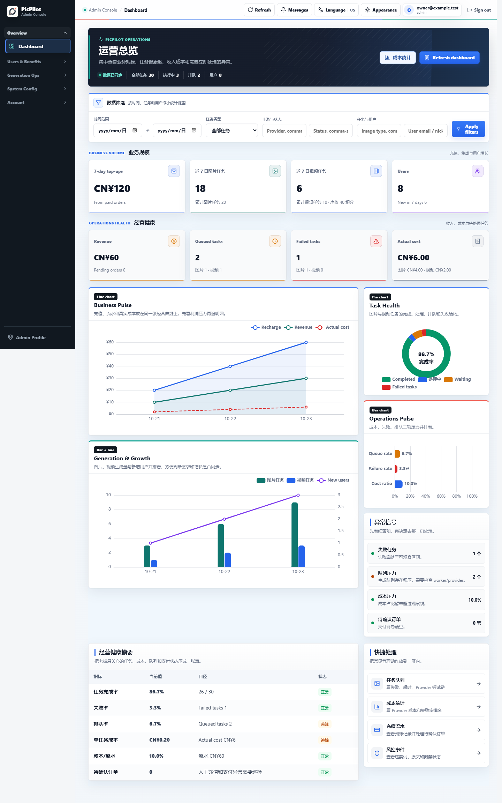
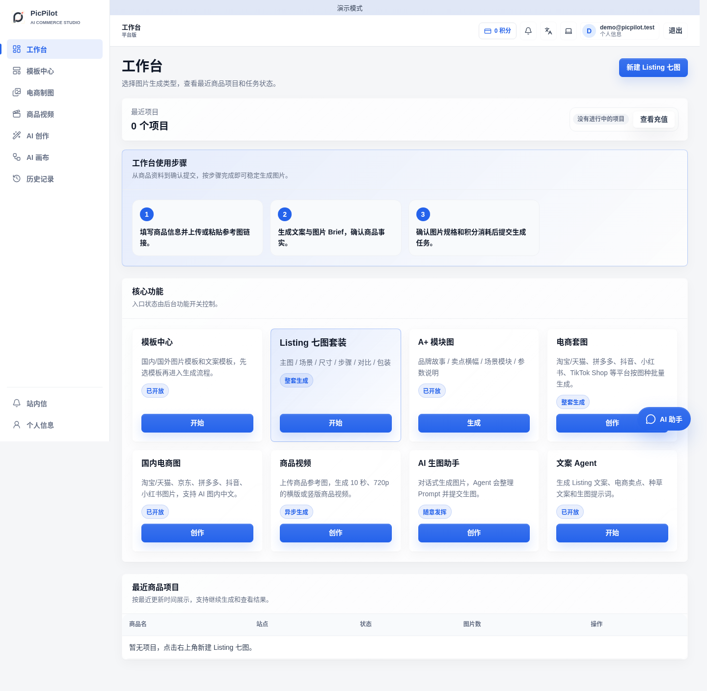
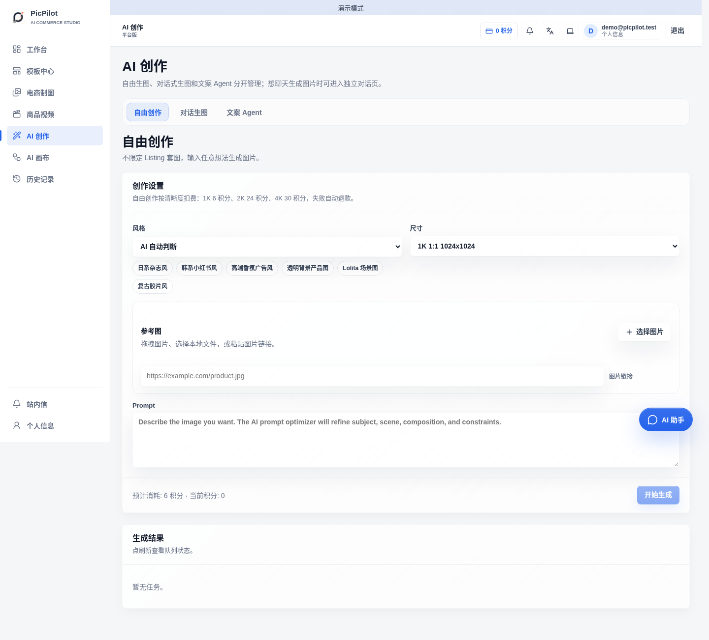
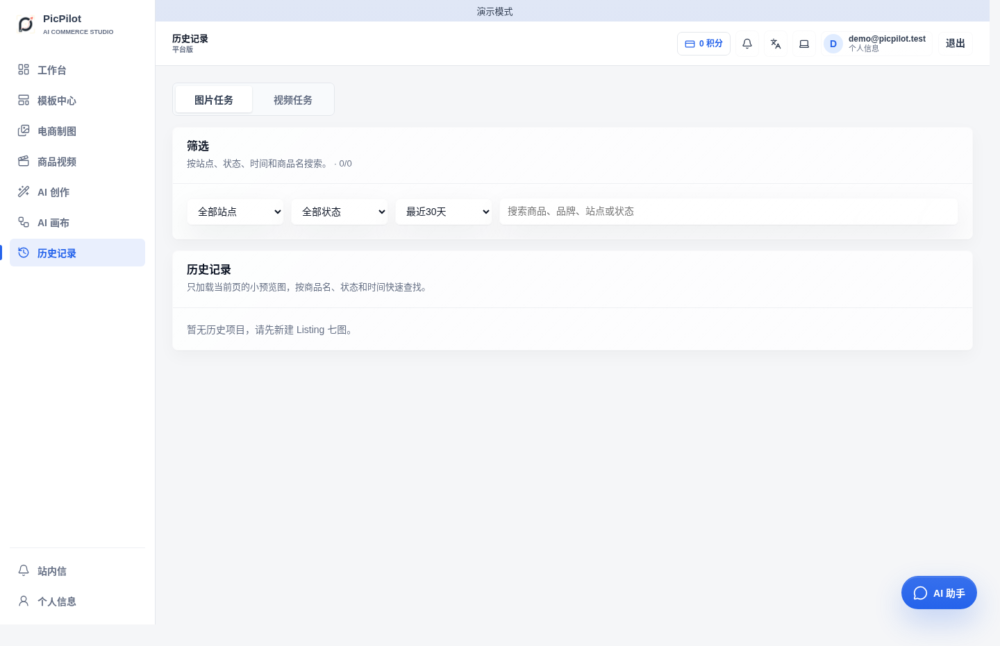

# PicPilot Platform

[简体中文](README.md) | [English](README.en.md) | [日本語](README.ja.md)

面向多用户团队的开源 AI 创作与电商视觉平台，支持图片生成、视频生成、电商创作、参考图、自由画布、Provider 路由、积分/充值和运营后台。Go 负责业务、任务与存储，React/Next.js 负责界面。

> **当前状态：公开迁移验收版。** 首次部署请使用新数据库，不要连接旧 Java 生产数据库。

## 版本选择

| 仓库 | 适用场景 |
| --- | --- |
| `suakitsu/picpilot-platform` | 多用户运营、管理员后台、积分、充值和风控 |
| `suakitsu/picpilot-personal` | 个人自托管，自己配置 Provider，不含平台计费和管理后台 |

两个 Go 仓库都包含完整源码和 `core` 快照，克隆任意一个即可构建。

## 快速启动

需要 Git、Docker Engine/Docker Desktop 和 Docker Compose v2。首次构建建议准备 4 核 CPU、8 GB 内存和 10 GB 磁盘。

```sh
git clone https://github.com/suakitsu/picpilot-platform.git
cd picpilot-platform
```

Windows PowerShell：

```powershell
./scripts/init.ps1
docker compose up -d --build
docker compose ps
docker compose exec api /picpilot --setup-token
```

Linux / macOS：把第一行替换为 `sh scripts/init.sh`，后续命令相同。

1. 打开 `http://localhost:8080`，用终端显示的一次性初始化令牌创建首个管理员。
2. 打开 `http://localhost:8081` 登录管理后台。
3. 在 Provider 配置中填写真实协议、模型、地址和密钥，验证后再启用。

新安装没有默认账号或密码；注册、支付和 Local Worker Provider 默认关闭。不要删除数据卷中的 `instance-secrets.json`，否则已保存的 Provider 密钥无法解密。

## Provider 与本地网关

已配置的 Provider Base URL 同时支持 `http://` 和 `https://`，也可以使用 `http://127.0.0.1:8888/v1` 这类本机网关。容器访问宿主机网关时，Docker Desktop 使用 `host.docker.internal`。用户提交的外部图片引用仍使用严格安全下载策略。

Provider 必须与上游真实协议兼容；填写厂商名称不会自动兼容任意 API。配置检查不会调用付费模型。

## 界面预览









## 部署与维护

- 默认仅监听 `127.0.0.1:8080/8081`，PostgreSQL 不开放宿主机端口。
- 对公网提供服务时，请在网关或反向代理层配置 HTTPS，并同步设置公开 URL。
- 备份 `.env`、数据库、上传文件和 `instance-secrets.json`；不要把它们提交到 Git。
- 日常停机使用 `docker compose stop`。`docker compose down -v` 会删除数据卷。

更多内容：

- [配置、HTTPS 与 Local Worker](docs/configuration.md)
- [备份、恢复、升级与回滚](docs/operations.md)
- [测试与安全边界](docs/testing.md)
- [实施与验收状态](docs/implementation-status.md)

## 许可

PicPilot 自有代码采用 [MIT](LICENSE)。内置的 Nova 数据和两个画布项目保留 AGPL-3.0；包含这些内容的组合应用按 AGPL-3.0 发布。完整范围和第三方清单见 [LICENSING.md](LICENSING.md)。
